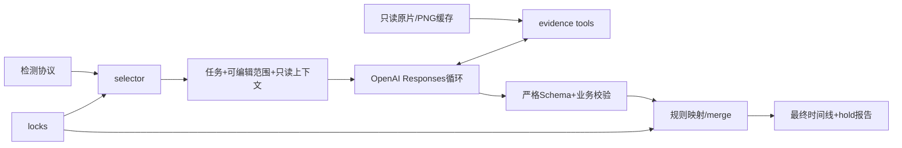

# 架构与状态

任务状态：prepared→reviewing→补取证据→decided或hold→validated→merged。没有配置、API预算耗尽、接口失败或非法结果进入hold，保留补齐线索，不把它当static。

模块边界：prepare只做路由和不可变快照；EvidenceProvider控制文件身份、PTS、可读范围和像素；backend只执行允许的图像工具；models执行分段业务校验；merge是最终时间和动作的拥有者。

模型状态不回写检测器。文件协议消除跨仓库代码耦合，原片只读。首次取证允许按关键帧补解码，窗口内连续获取所需帧并持久缓存；后续按证据ID复用。
