# 架构与状态

```mermaid
flowchart LR
  A[检测协议] --> B[selector]
  B --> C[任务+可编辑范围+只读上下文]
  C --> D[OpenAI Responses循环]
  E[只读原片/PNG缓存] --> F[evidence tools]
  D <--> F
  D --> G[严格Schema+业务校验]
  G --> H[规则映射/merge]
  I[locks] --> B
  I --> H
  H --> J[最终时间线+hold报告]
```

任务状态：prepared→reviewing→补取证据→decided或hold→validated→merged。没有配置、API预算耗尽、接口失败或非法结果进入hold，保留补齐线索，不把它当static。

## Python模块职责

以下模块位于`motion_evidence`包内。`prepare`、`review`、`merge`和`report`仍是CLI命令，不作为模块命名。

| 模块 | 职责 |
|---|---|
| `cli` | 构建命令解析器并调度，不承担媒体或裁决实现。 |
| `artifacts` | 运行文件I/O、指纹与不可变准备快照的加载校验。 |
| `catalog` | 源清单校验、帧身份、真实PTS/时间映射与边界。 |
| `intervals` | 帧序号上的半开区间合并与扣除。 |
| `policy` | 规则版本及活动性质到动作的映射，不依赖检测器或API。 |
| `planning` | 校验检测产物，生成基线、锁定范围、有界任务和不可变快照。 |
| `evidence` | 按精确PTS取原图，约束context/ROI，复用原帧与PNG缓存。 |
| `openai_backend` | 加载配置，编排Responses/允许的取证工具、累计预算、恢复和清洗日志。 |
| `schemas` | 严格结果结构，以及引用、已查看边界和完整覆盖的业务校验。 |
| `timeline` | 按版本选取裁决，执行locks/AI/hold/baseline优先级并校验最终覆盖。 |

模型状态不回写检测器。文件协议消除跨仓库代码耦合，原片只读。首次取证允许按关键帧补解码，窗口内连续获取所需帧并持久缓存；后续按证据ID复用。
